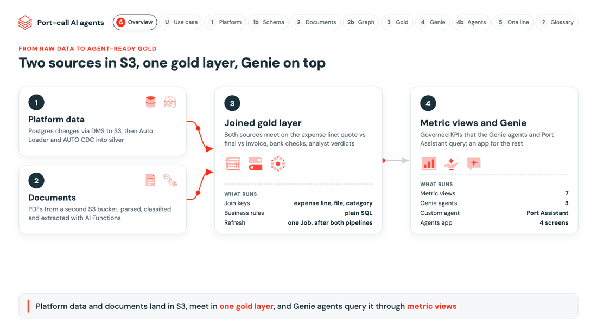

# ai-agent-demo

A port-call data platform on Databricks with AI agents on top. Two sources land in S3: the DA database (Aurora
PostgreSQL, copied by AWS DMS) and the PDFs (quotes, final DA packs, statements of facts). They meet in one gold
layer that Genie agents and an agents app work on.

[](https://koritadenada.github.io/ai-agent-demo/architecture.html)

[Open the animated architecture](https://koritadenada.github.io/ai-agent-demo/architecture.html) · details:
[platform pipeline](src/pipelines/platform/README.md) · [document pipeline](src/pipelines/documents/README.md) ·
[agents app](src/app/README.md)

## What runs

| Part | Built with |
|---|---|
| Platform data to silver | Auto Loader and AUTO CDC on the DMS files |
| Documents to silver | AI Functions: parse, classify, map each page to its DA line, read amounts and bank details |
| Gold | Plain SQL: each final line against its quote, its invoice page and the analyst's check |
| Genie agents | Port costs, DA audit, DA operations, on 7 metric views |
| Agents app | AppKit: DA review, Quote Negotiator, port call timelines, and the Port Assistant (a custom agent over the Genie agents and the documents); chat history in Lakebase, traces in Unity Catalog |

Everything runs as the signed-in user and writes nothing without a confirm.

## Run it

```bash
V=(--profile <profile> --var catalog=<catalog>)    # bash and zsh
databricks bundle deploy -t demo "${V[@]}"         # ends with a link to every resource
databricks bundle run mock_data -t demo "${V[@]}"  # demo data: DMS files and 72 PDFs
databricks bundle run setup -t demo "${V[@]}"      # functions, prompts, pipelines, metric views, agent tools
databricks bundle run agents_app -t demo "${V[@]}"
```

On your AWS account: apply `infra/terraform` (IAM role and storage credential), then deploy `-t prod` with
`--var storage_credential_name=... --var dms_bucket_url=... --var documents_bucket_url=...`. Check the assumed
lookup tables in the [platform pipeline README](src/pipelines/platform/README.md), section "Adapting it to your
environment".

## Repo

```
databricks.yml, resources/   the bundle: pipelines, jobs, Genie agents, app, Lakebase, experiments
src/pipelines/               platform, documents, gold
src/app/                     the agents app (AppKit) and its agents
src/agents/                  agent tools (UC functions) and the app tables
src/deploy/                  what bundles cannot deploy: UC functions, metric views, prompts
src/mock_data/               the demo data generator
infra/terraform/             the AWS side
scripts/, tests/             deploy links, end-to-end test
```

## Design

- **The AI reads, SQL decides.** Models read each PDF once; verdicts, benchmarks and bank checks are SQL.
- **Scored against the analysts.** Every verdict sits next to the analyst's own check.
- **Prompts change without a deploy.** Every model call loads its prompt from the MLflow Prompt Registry.
- **Safe by default.** Masked accounts in gold, the user's permissions in the app, thresholds as variables.
