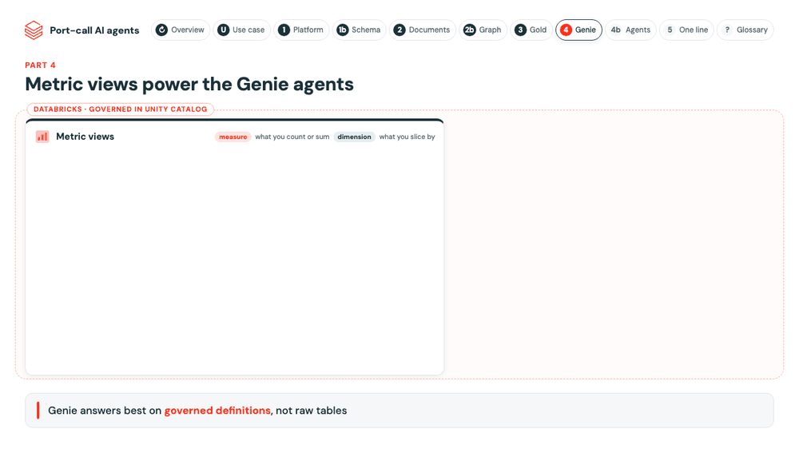

# Agents

Six agents on the gold layer: three Genie agents, each owning one data area, and three code agents in the
[agents app](../app/README.md). Every agent runs as the signed-in user, so Unity Catalog decides what each person
sees, and none writes anything without the analyst's confirm.

| Agent | Kind | What it does | Tools or data | Prompt | Where |
|---|---|---|---|---|---|
| Port costs | Genie agent | Cost per call, final vs quote, benchmarks, savings, competing quotes, flagged open quotes | Metric views `benchmark_savings_metrics`, `port_call_cost_metrics`, `rfq_quote_metrics`; table `quote_benchmark_flags` | Instructions and sample questions in the space | [`agents.genie.yml`](../../resources/agents.genie.yml) |
| DA audit | Genie agent | Final lines vs quote and invoice page, verdicts, analyst checks, bank checks, payments on hold, document quality | Metric views `expense_reconciliation_metrics`, `payment_validation_metrics`, `document_quality_metrics`; tables `expense_reconciliation`, `payment_validation` | Instructions and sample questions in the space | [`agents.genie.yml`](../../resources/agents.genie.yml) |
| DA operations | Genie agent | Appointments, cancellations, workflow durations, statement of facts events | Metric view `da_workflow_metrics`; tables `da_workflow`, `port_call_costs`, `port_call_events` | Instructions and sample questions in the space | [`agents.genie.yml`](../../resources/agents.genie.yml) |
| Port Assistant | Code agent, keeps the conversation | Answers questions in plain language; calls several tools for one question when needed | The three Genie agents; UC functions `search_documents`, `port_call_timeline` | `port_assistant` (registry) | [`port-assistant`](../app/server/agents/port-assistant/agent.ts), Port Assistant screen |
| Quote Negotiator | Code agent, one-shot | Drafts the negotiation email for an open PDA quote; every amount checked against the data | `get_quote`, `get_price_history`, `get_competing_quotes`, `submit_draft` (SQL on gold) | `negotiator` (registry) | [`quote-negotiator`](../app/server/agents/quote-negotiator/agent.ts), Open quotes screen |
| Timeline Summarizer | Code agent, one-shot | Writes the account of a port call from its statement of facts, citing the page of each event | `get_port_call` (SQL on gold and silver) | `port_call_story` (registry) | [`timeline-summarizer`](../app/server/agents/timeline-summarizer/agent.ts), Port calls screen |

**Code agents** are AppKit agents ([`server/agents`](../app/server/agents)): a model (`agent_llm_endpoint`), a system
prompt from the MLflow Prompt Registry (app schema, alias `production`, changes without a deploy) and tools. The Port
Assistant's conversations are kept in Lakebase. Every turn is traced to the `portcall-agent-traces` experiment, with a
span per model call and per tool call, stored as Delta tables in the app schema.

**In this folder:** the Port Assistant's two UC functions ([`tools`](tools)) and the tables the app writes to after a
confirm ([`state.sql`](state.sql)): `analyst_decisions` (accept, dispute, hold) and `negotiation_drafts`. The setup
job applies them ([`apply_agents.py`](../deploy/apply_agents.py)).
