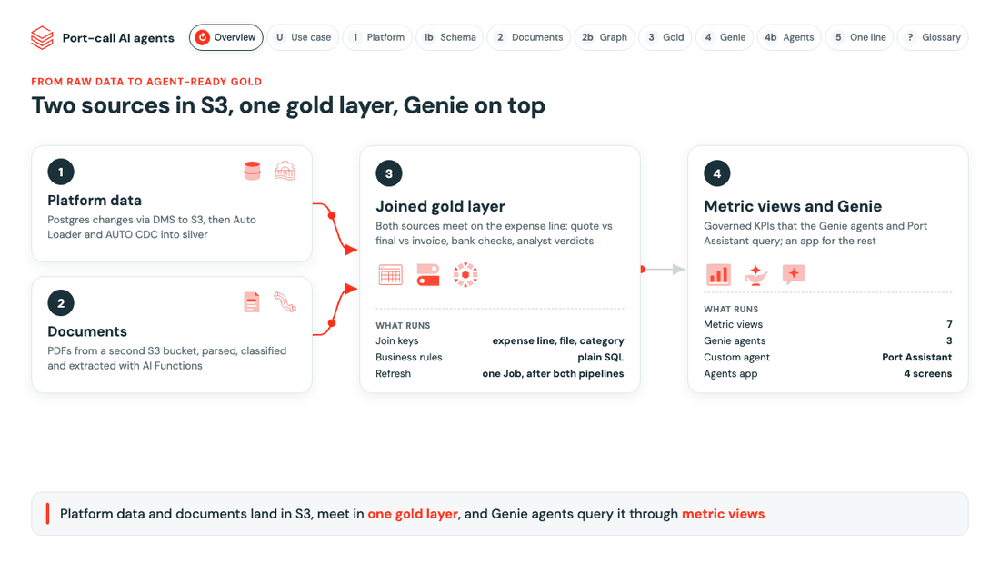

# Pipelines

Three Lakeflow Spark Declarative Pipelines, run in order by the `refresh` job (serverless). Each reads the layer
before it and is deployed by the bundle (`resources/*.pipeline.yml`).

| Pipeline | From | To | Built with | Details |
|---|---|---|---|---|
| Platform | DMS files in S3 (full load and CDC) | silver, one current table per source table | Auto Loader, AUTO CDC | [platform](platform/README.md) |
| Documents | PDFs in S3 (quotes, final DA packs, statements of facts) | silver, facts with page citations | AI Functions | [documents](documents/README.md) |
| Gold | both silvers | gold, each final line checked | Plain SQL | [gold](gold/README.md) |

