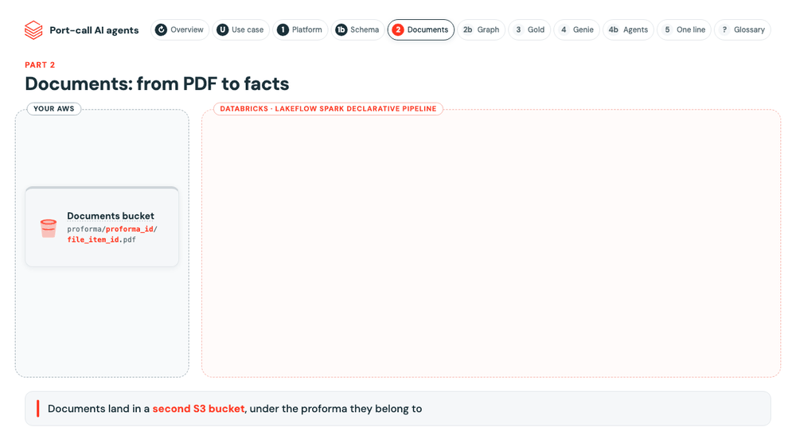

# Documents pipeline

Reads every PDF in the documents bucket once and turns it into facts with page citations: the text of each page,
which DA expense line each page evidences, the amounts, bank details, date and rate of exchange printed on it, and
the timeline of the port call.

[](https://koritadenada.github.io/ai-agent-demo/architecture.html)

**One model call per invoice page.** The page map reads the amount in the same call, so invoice pages do not go to
`ai_extract` a second time (about 40% less AI spend). `ai_extract` stays for bank details, where its per-field
confidence feeds the 0.8 floor. A statement of facts is read in one call for the whole document, so a timeline over
several pages keeps one order; each event keeps its page.

There is no bronze copy of the PDFs: they never change, so the bucket is the raw layer and Auto Loader reads it
directly. Every model result is stored once, so nothing downstream calls a model again.

## Prompts: where they live and how to change them

Every model call loads its prompt from the MLflow Prompt Registry (silver schema, alias `production`) when a run
starts. For `ai_query` steps the model is the `model` tag of the prompt version. Browse them in the MLflow
experiment `portcall-prompts`, **Prompts** tab: `document_type`, `page_map`, `bank_details`,
`sof_events`.

[`utilities/prompts.py`](utilities/prompts.py) only seeds version 1 on the first deploy (setup job); after that the
registry is the source of truth.

**To change a prompt or its model:** register a new version and move `production` to it.

```python
import mlflow
mlflow.set_registry_uri("databricks-uc")
name = "<catalog>.<silver schema>.page_map"
v = mlflow.genai.register_prompt(name=name, template="...", tags={"model": "databricks-claude-sonnet-4-5"})
mlflow.genai.set_prompt_alias(name=name, alias="production", version=v.version)
```

- No deploy: the next run uses it. Roll back by moving the alias back.
- New documents only: pages already processed keep their result.
- Every row records the version that produced it (`prompt_version`); compare versions with `Agreement with analysts`.
- Keep the placeholders (`{{expense_lines}}`, `{{categories}}`, `{{page_text}}`, `{{document_text}}`).

Shared settings, the prompt loader and the expense vocabulary are in [`utilities/settings.py`](utilities/settings.py).
