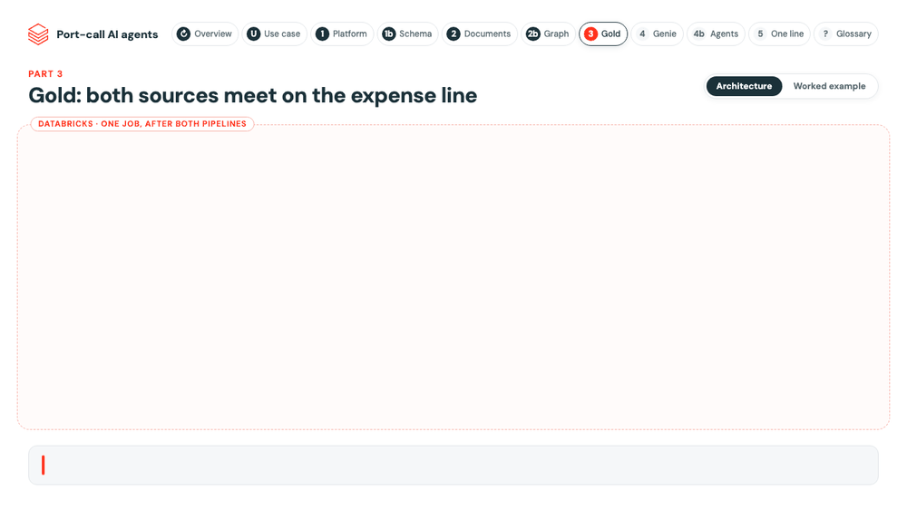

# Gold pipeline

Where the two sources meet: each final DA line against its quote, the invoice page that evidences it, the benchmark
for the port and the analyst's own check. Plain SQL materialized views; no model runs here.

| Table | One row per | What it answers |
|---|---|---|
| [`port_call_costs`](transformations/port_call_costs.sql) | port call | Quoted (PDA) vs final (FDA) cost in DA currency and EUR, vessel, port, agent, workflow dates |
| [`expense_reconciliation`](transformations/expense_reconciliation.sql) | final DA line | Quote, final and invoiced amount, cited pages, rate of exchange, verdict with explanation, analyst verdict |
| [`port_bill_analysis`](transformations/port_bill_analysis.sql) | final DA | Analysis status and every amount check with its verdict, pages and explanation |
| [`payment_validation`](transformations/payment_validation.sql) | final DA pack | Bank account, SWIFT, total and date on the document vs the platform; accounts masked |
| [`expense_benchmarks`](transformations/expense_benchmarks.sql) | port, vessel type, size, expense | Median final cost in EUR at three levels, regional and local port minimum |
| [`quote_benchmark_flags`](transformations/quote_benchmark_flags.sql) | quoted line of an open PDA | The quote against the benchmark, flagged when too high, with the potential saving |
| [`rfq_comparison`](transformations/rfq_comparison.sql) | request case, expense | Accepted quote vs the lowest and highest one received |
| [`da_workflow`](transformations/da_workflow.sql) | port call | Appointment, PDA, FDA and verification states and the hours between steps |
| [`document_quality`](transformations/document_quality.sql) | document | Classified type, pages, parse errors and the confidence of each AI step |

**Rules, not models.** A line's verdict is the first rule that fires: currency mismatch, no evidence, invoice vs
final, over or under the quote, else match. A rate of exchange is never invented: without one on the document or the
platform the analysis stops for that line. A benchmark level is used only with enough past lines, else the next one.

**Thresholds are bundle variables** (`databricks.yml`), passed to the pipeline as configuration:

| Variable | Default | Meaning |
|---|---|---|
| `match_tolerance_pct` | 2 | Final vs quote difference still a match (percent) |
| `dispute_threshold_pct` | 10 | Final vs quote difference above which a line is disputed (percent) |
| `min_benchmark_sample` | 3 | Past lines a benchmark level needs before it is used |
| `quote_flag_pct` | 10 | Quote above the benchmark median by more than this is flagged (percent) |

The bank checks are Unity Catalog functions ([`src/uc_functions`](../../uc_functions)) so agents can reuse them; the
metric views on top of these tables ([`src/metric_views`](../../metric_views)) feed the Genie agents.
